# 🧭 The State of Todo - Full Stack Understanding

## One clean interface built four times to master browser memory, LocalStorage, JSON parsing, and asynchronous Fetch requests.

### One Todo app, rebuilt five ways — from a bare DOM script to a real REST API with a persistent backend.

*A hands-on, code-first journey that shows **why** every layer of a full-stack application exists, by making you feel the limitation that forces the next one.*

<br>


**[The Idea](#-the-idea) · [The Journey](#-the-learning-journey) · [Architecture](#-architecture-of-the-final-stage) · [Quick Start](#-quick-start) · [API](#-api-reference) · [Deep Dives](#-deep-dives) · [Limitations](#-honest-limitations--roadmap)**

</div>

---

## 📑 Table of Contents

- [The Idea](#-the-idea)
- [The Learning Journey](#-the-learning-journey)
- [Stage-by-Stage Comparison](#-stage-by-stage-comparison)
- [Architecture of the Final Stage](#-architecture-of-the-final-stage)
- [Request Lifecycle](#-request-lifecycle)
- [Quick Start](#-quick-start)
- [API Reference](#-api-reference)
- [Deep Dives](#-deep-dives)
- [Project Structure](#-project-structure)
- [Core Concepts Cheat Sheet](#-core-concepts-cheat-sheet)
- [Honest Limitations & Roadmap](#-honest-limitations--roadmap)
- [What You'll Be Able to Do After This](#-what-youll-be-able-to-do-after-this)

---

## 💡 The Idea

Most tutorials hand you a finished full-stack app and ask you to admire it. This repository does the opposite.

It takes **one deliberately tiny product — a Todo list — and keeps the UI identical** across every stage (same HTML, same CSS). Only the *plumbing underneath* changes. Because nothing else moves, you can see precisely what each new technology buys you and, just as importantly, what it still can't do.

> **The rule of this repo:** you don't adopt the next layer until the current one has visibly failed you.

| You feel this pain… | …so you learn this |
| :-- | :-- |
| "I refreshed and my tasks vanished." | **`localStorage`** |
| "My phone doesn't have my laptop's tasks." | **HTTP + `fetch()`** |
| "`fetch` can't touch a file — and the fake API forgets everything." | **A real server with Node.js + Express** |
| "I want the data to survive a restart." | **File persistence (`fs`) behind a REST API** |

---

## 🗺 The Learning Journey

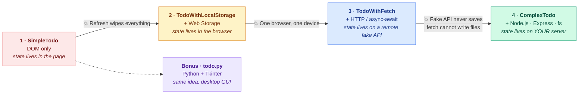

### Where does the data actually live at each stage?

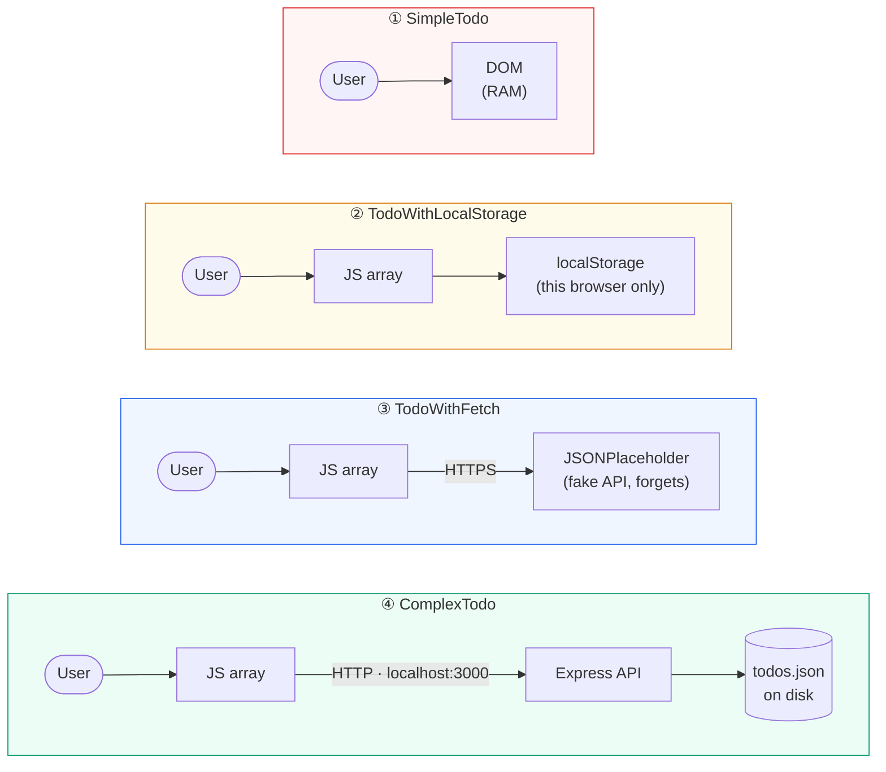

---

## 📊 Stage-by-Stage Comparison

| | ① SimpleTodo | ② LocalStorage | ③ Fetch | ④ ComplexTodo |
| :-- | :--: | :--: | :--: | :--: |
| **Survives page refresh** | ❌ | ✅ | ❌ *(fake API)* | ✅ |
| **Survives clearing the browser** | ❌ | ❌ | ❌ | ✅ |
| **Shared across devices** | ❌ | ❌ | ❌ | ✅ *(one server)* |
| **Has a backend** | ❌ | ❌ | 🟡 *(someone else's)* | ✅ *(yours)* |
| **Uses HTTP** | ❌ | ❌ | ✅ | ✅ |
| **`async` / `await`** | ❌ | ❌ | ✅ | ✅ |
| **Server-side validation** | ❌ | ❌ | ❌ | ✅ |
| **Real status codes (201/400/404)** | ❌ | ❌ | 🟡 | ✅ |
| **Data model** | DOM nodes | `{id, title, completed}` | `{localId, apiId, …}` | `{id, title, completed}` |
| **Lines of JS** | 48 | 84 | 180 | 163 front · 152 back |
| **Core lesson** | DOM events | Persistence | Networking | Full-stack design |

> **Notice stage ③'s data model.** Because JSONPlaceholder doesn't really store new items, the client has to track a `localId` *and* an `apiId`. That awkward double-ID is the app telling you it wants a real backend.

---

## 🏗 Architecture of the Final Stage

`ComplexTodo` is a classic three-tier application: a static front end, a stateless REST API, and a JSON file standing in for a database.

```mermaid
flowchart LR
    LS["🛠 VS Code Live Server<br/>:5500<br/><i>serves the static files</i>"]

    subgraph Client["🖥 Client — Browser"]
        direction TB
        UI["index.html + style.css<br/><i>Static UI</i>"]
        JS["script.js<br/>loadTodos · addTodo<br/>updateTodo · deleteTodo<br/>renderTodos"]
        UI <--> JS
    end

    subgraph Server["⚙️ Server — Node.js + Express 5 (:3000)"]
        direction TB
        MW1["cors()<br/><i>allow cross-origin</i>"]
        MW2["express.json()<br/><i>parse request body</i>"]
        R["Routes<br/>GET · GET/:id · POST<br/>PATCH/:id · DELETE/:id"]
        H["Helpers<br/>readTodos() · writeTodos()"]
        MW1 --> MW2 --> R --> H
    end

    F[("💾 todos.json")]

    LS -- "HTML · CSS · JS" --> UI
    JS -- "fetch() · JSON over HTTP" --> MW1
    R -. "JSON + status code" .-> JS
    H -- "fs.readFileSync<br/>fs.writeFileSync" --> F

    classDef client fill:#eff6ff,stroke:#2563eb,color:#1e3a8a
    classDef server fill:#ecfdf5,stroke:#059669,color:#064e3b
    classDef disk fill:#fef3c7,stroke:#d97706,color:#78350f
    classDef dev fill:#f3f4f6,stroke:#6b7280,color:#111827
    class UI,JS client
    class MW1,MW2,R,H server
    class F disk
    class LS dev
    style Client fill:#f8fbff,stroke:#2563eb
    style Server fill:#f6fffa,stroke:#059669
```

### Why two different ports?

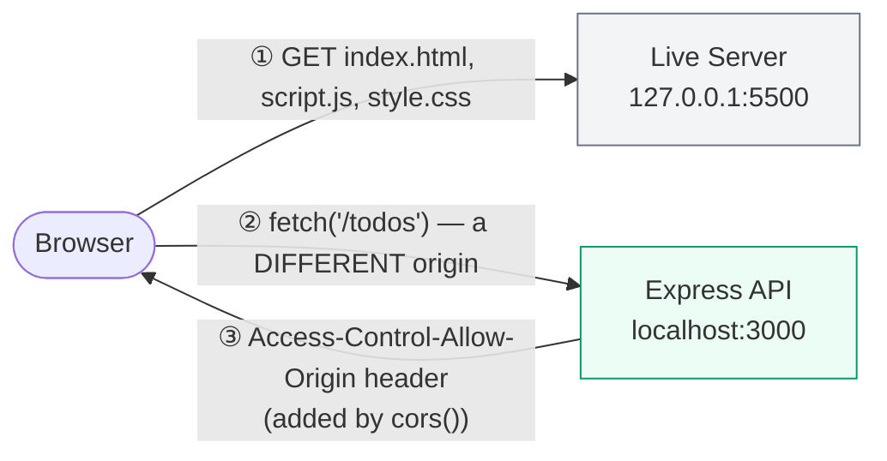

The page is served from **`:5500`** but calls an API on **`:3000`**. Different port = different *origin*, so the browser enforces CORS. The one-line `app.use(cors())` in `server.js` is what makes step ③ possible. Remove it and every request fails in the console — a great experiment to run.

---

## 🔁 Request Lifecycle

### Adding a todo (`POST /todos`)

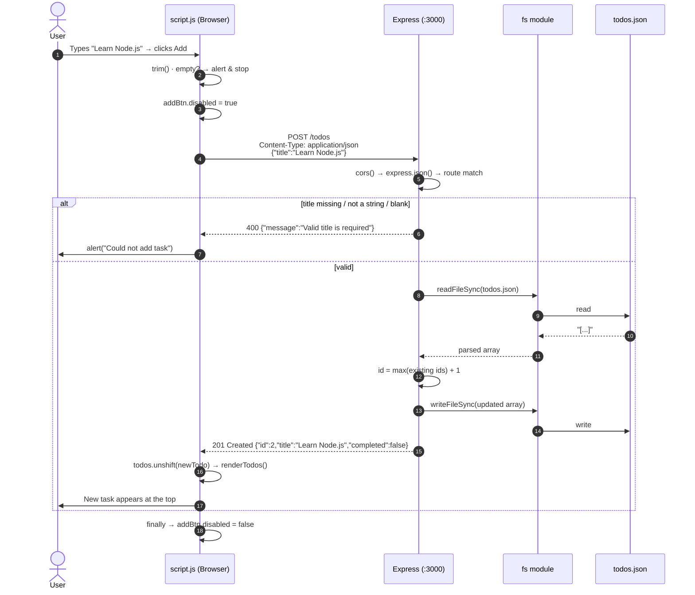

### Page load, toggle & delete

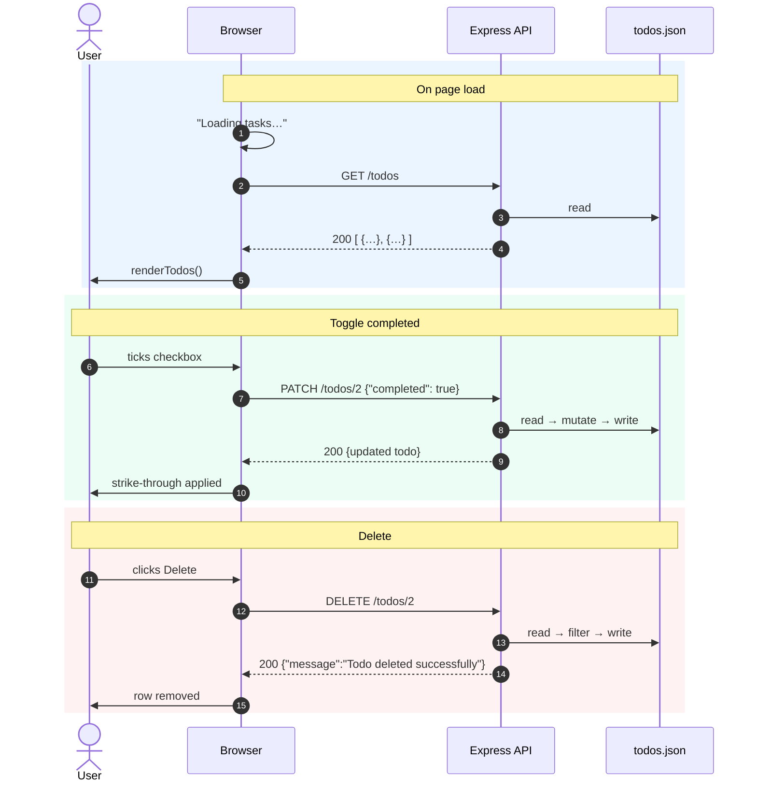

### How `PATCH /todos/:id` decides what to do

Every branch below exists in `backend/server.js`.

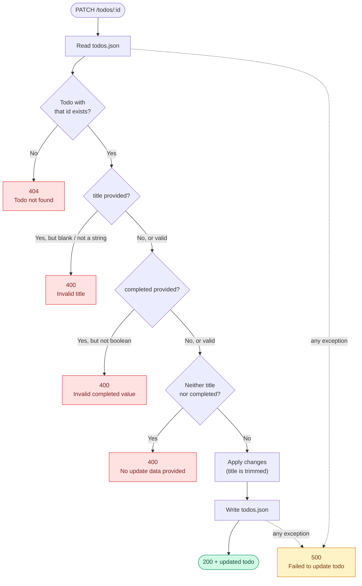

### The lifecycle of a single todo

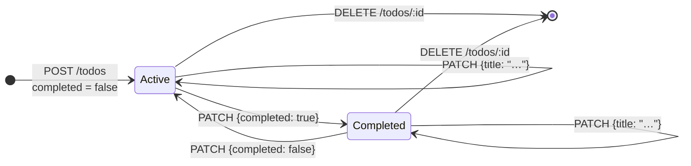

---

## 🚀 Quick Start

### Prerequisites

| Tool | Version | Needed for |
| :-- | :-- | :-- |
| [Node.js](https://nodejs.org) | **18 or newer** (Express 5 requirement) | Stage ④ backend |
| A modern browser | Any evergreen | Stages ①–④ |
| [VS Code](https://code.visualstudio.com) + *Live Server* | Optional | Serving the front end |
| Python 3 with `tkinter` | 3.8+ | Bonus desktop app only |

### Stages ①, ② and ③ — front-end only

No install. No build step. Pick a folder and open it.

```bash
cd SimpleTodo            # or TodoWithLocalStorage, or TodoWithFetch
# Option A: VS Code → right-click index.html → "Open with Live Server"
# Option B: any static server
python3 -m http.server 5500
```

Then visit **http://127.0.0.1:5500**.

### Stage ④ — the full-stack app

You need **two terminals**: one for the API, one for the front end.

**Terminal 1 — start the API**

```bash
cd ComplexTodo/backend
npm install
npm start
# → Todo API running at http://localhost:3000
```

**Terminal 2 — serve the front end**

```bash
cd ComplexTodo
python3 -m http.server 5500
# or use VS Code Live Server on index.html
```

Open **http://127.0.0.1:5500** and add a task. Then stop *both* servers, start the API again, and reload — your task is still there. That's persistence. 🎉

**Smoke-test the API without the UI**

```bash
# Create
curl -i -X POST http://localhost:3000/todos \
  -H "Content-Type: application/json" \
  -d '{"title":"Learn Node.js"}'

# Read
curl http://localhost:3000/todos
curl http://localhost:3000/todos/1

# Update
curl -X PATCH http://localhost:3000/todos/1 \
  -H "Content-Type: application/json" \
  -d '{"completed":true}'

# Delete
curl -X DELETE http://localhost:3000/todos/1

# See the validation layer reject bad input (expect 400)
curl -i -X POST http://localhost:3000/todos \
  -H "Content-Type: application/json" -d '{"title":"   "}'
```

### Bonus — Python desktop app

```bash
python3 todo.py
```

Tasks are saved to `mytask.json` in the working directory.

> 💡 **Troubleshooting**
> | Symptom | Likely cause | Fix |
> | :-- | :-- | :-- |
> | "Failed to load tasks" in the UI | API isn't running | Start it with `npm start` in `ComplexTodo/backend` |
> | CORS error in the console | `cors()` removed, or request goes to the wrong origin | Keep `app.use(cors())`; verify `API_URL` |
> | `EADDRINUSE :3000` | Something else is using the port | Stop it, or change `PORT` in `server.js` **and** `API_URL` in `script.js` |
> | `ModuleNotFoundError: tkinter` | Tk not installed | Linux: `sudo apt install python3-tk` |

---

## 📡 API Reference

**Base URL:** `http://localhost:3000` · **Format:** JSON · **Auth:** none

### The resource

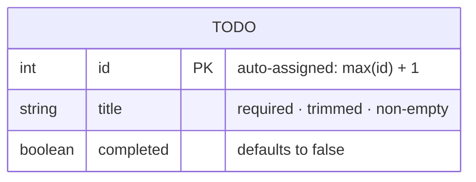

### Endpoints

| Method | Endpoint | Description | Body | Success | Errors |
| :--: | :-- | :-- | :-- | :--: | :-- |
| `GET` | `/todos` | List all todos | — | `200` array | `500` |
| `GET` | `/todos/:id` | Get one todo | — | `200` object | `404` · `500` |
| `POST` | `/todos` | Create a todo | `{ "title": string }` | `201` object | `400` · `500` |
| `PATCH` | `/todos/:id` | Partially update | `{ "title"?: string, "completed"?: boolean }` | `200` object | `400` · `404` · `500` |
| `DELETE` | `/todos/:id` | Remove a todo | — | `200` `{ message }` | `404` · `500` |

### Example exchange

<table>
<tr><th>Request</th><th>Response</th></tr>
<tr>
<td>

```http
POST /todos HTTP/1.1
Host: localhost:3000
Content-Type: application/json

{ "title": "  Ship the README  " }
```

</td>
<td>

```http
HTTP/1.1 201 Created
Content-Type: application/json

{
  "id": 2,
  "title": "Ship the README",
  "completed": false
}
```

</td>
</tr>
</table>

### Error format

Every error returns the same shape, so clients need only one handler:

```json
{ "message": "Todo not found" }
```

| Status | Meaning here |
| :--: | :-- |
| `400` | Bad input — blank/non-string `title`, non-boolean `completed`, or an empty PATCH |
| `404` | No todo with that `id` (including non-numeric ids, which become `NaN`) |
| `500` | The JSON file couldn't be read, parsed or written |

---

## 📚 Deep Dives

Two of the folders carry short write-ups that explain the *why*. They're worth reading alongside the code.

| Document | What it teaches |
| :-- | :-- |
| [`Basics.md`](./Basics.md) | The mental model: server vs. local server, HTTP request anatomy, URL anatomy, **endpoint vs. route**, what an API really is (with a restaurant analogy), and a five-question self-check. |
| [`TodoWithLocalStorage/Drawbacks.md`](./TodoWithLocalStorage/Drawbacks.md) | Why `localStorage` isn't enough: browser/device-bound, ~5 MiB cap, readable by any script on the page, no queries, no accounts. |
| [`TodoWithFetch/Drawbacks.md`](./TodoWithFetch/Drawbacks.md) | What `fetch()` can and **cannot** do, why JSONPlaceholder never persists writes, and the three ideas to internalise: `JSON.stringify`, `response.json()`, `async/await`. |

### Concept map

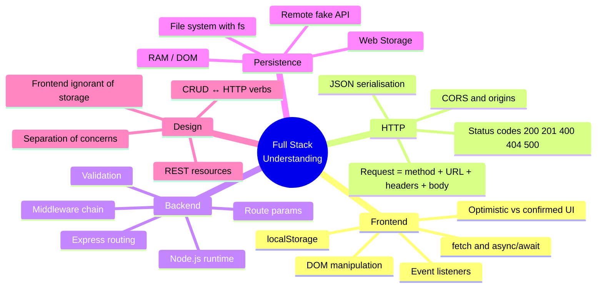

### CRUD ↔ HTTP ↔ code, in one view

| CRUD | HTTP | Express route | Front-end function |
| :-- | :-- | :-- | :-- |
| **C**reate | `POST /todos` | `app.post("/todos", …)` | `addTodo()` |
| **R**ead | `GET /todos` | `app.get("/todos", …)` | `loadTodos()` |
| **R**ead one | `GET /todos/:id` | `app.get("/todos/:id", …)` | *(API only)* |
| **U**pdate | `PATCH /todos/:id` | `app.patch("/todos/:id", …)` | `updateTodo()` |
| **D**elete | `DELETE /todos/:id` | `app.delete("/todos/:id", …)` | `deleteTodo()` |

---

## 🗂 Project Structure

```text
FullStackUnderstanding/
│
├── 📘 README.md
├── 📘 Basics.md                      # Server / HTTP / endpoint / route / API explained
│
├── 1️⃣  SimpleTodo/                    # DOM only — data dies on refresh
│   ├── index.html
│   ├── style.css
│   └── script.js
│
├── 2️⃣  TodoWithLocalStorage/          # + Web Storage
│   ├── index.html · style.css · script.js
│   └── Drawbacks.md
│
├── 3️⃣  TodoWithFetch/                 # + HTTP against JSONPlaceholder
│   ├── index.html · style.css · script.js
│   └── Drawbacks.md
│
├── 4️⃣  ComplexTodo/                   # + your own Express API
│   ├── index.html · style.css · script.js
│   └── backend/
│       ├── server.js                 # 5 routes, validation, fs-backed storage
│       ├── todos.json                # the "database"
│       └── package.json
│
├── 🐍 todo.py                        # Bonus: Tkinter desktop version
└── 🐍 mytask.json                    # ...and its storage file
```

### Code map — where to look for what

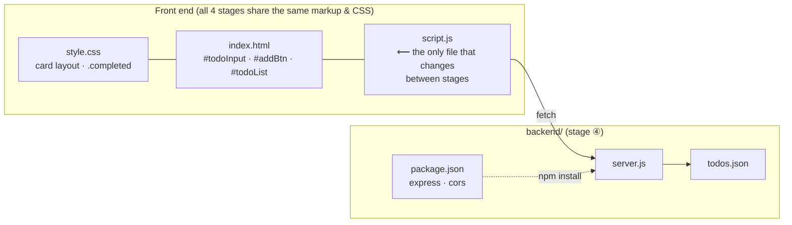

---

## 🧠 Core Concepts Cheat Sheet

| Term | In this project |
| :-- | :-- |
| **Server** | The Node.js process running `server.js` |
| **Local server** | `localhost:3000` (API) and `127.0.0.1:5500` (Live Server) |
| **HTTP request** | Method + URL + headers + optional body, sent by `fetch()` |
| **Requested URL** | `http://localhost:3000/todos/10` |
| **Endpoint** | `GET /todos` — method **and** URL together |
| **Route** | `app.get("/todos", …)` — the server-side rule that handles it |
| **Middleware** | `cors()` and `express.json()` — run before every route |
| **API** | The whole contract: *"send me these requests, I'll send you these responses"* |
| **Persistence** | Writing state somewhere that outlives the process (`todos.json`) |
| **CORS** | The browser rule that forced us to add `cors()` |

---

## ⚠️ Honest Limitations & Roadmap

This is a **learning project**, and the final stage is intentionally simple. Here is exactly where it would break in production — and what to learn next.

| # | Limitation (as implemented) | Why it matters | Next step |
| :-: | :-- | :-- | :-- |
| 1 | **Read-modify-write on a JSON file** with no locking | Two simultaneous writes can silently overwrite each other | Move to SQLite / PostgreSQL / MongoDB |
| 2 | **Synchronous** `readFileSync` / `writeFileSync` | Blocks the event loop on every request | Use `fs.promises` or a real database driver |
| 3 | **IDs are `max(id) + 1`** | Deleting the newest todo lets its id be reused | Auto-increment keys or UUIDs |
| 4 | **`cors()` allows every origin** | Fine locally; too open for a public API | `cors({ origin: "https://your-site" })` |
| 5 | **No authentication** — one global list | Every visitor sees and edits the same todos | JWT / sessions + a `userId` on each todo |
| 6 | `PORT` and `API_URL` are **hard-coded** | Awkward to deploy | `process.env.PORT`, a `config.js` on the client |
| 7 | **No automated tests** (`npm test` is the npm default stub) | Regressions go unnoticed | Jest + Supertest against the five routes |
| 8 | Client trusts a `200` and updates the UI only **after** the server responds | Correct, but slower to *feel* than optimistic UI | Optimistic updates with rollback |
| 9 | `todos.json` / `mytask.json` contain **sample data** | Noise in version control | `.gitignore` them; seed with `[]` |
| 10 | `node_modules/` is present in the project folder | Bloats the repo (~4.4 MB) | Add a `.gitignore` containing `node_modules/` |
| 11 | The Python app stores **plain strings**, not `{id, title, completed}` | Can't mark a task complete | Align its schema with the web version |

### Roadmap

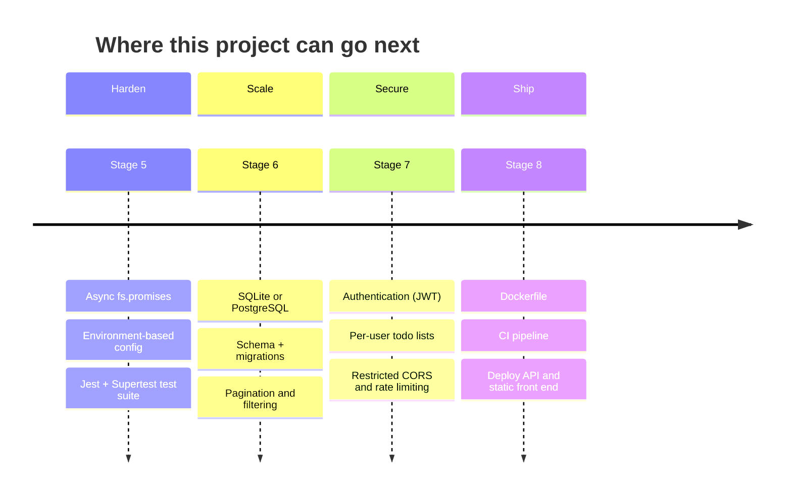

---

## 🎯 What You'll Be Able to Do After This

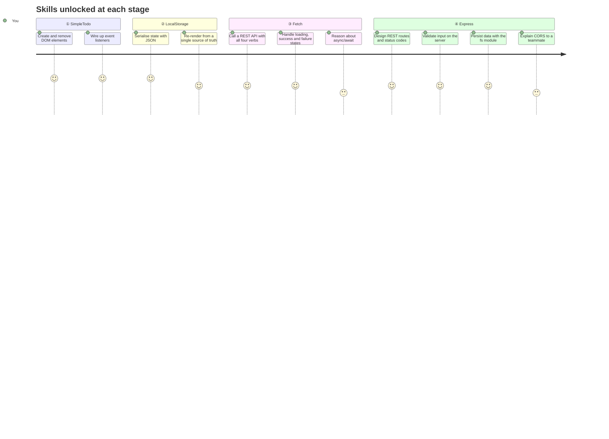

By the end you can look at any CRUD web app and immediately answer:

1. **Where does its state live?**
2. **What request does each button send?**
3. **Which route handles it?**
4. **Where is the data stored — and what happens when two users write at once?**

---

<div align="center">

### Built by **PavanKalyan**

*A computer science student learning full-stack development by building it from the ground up.*

⭐ If this helped you see how the pieces fit together, consider starring the repo.

</div>
